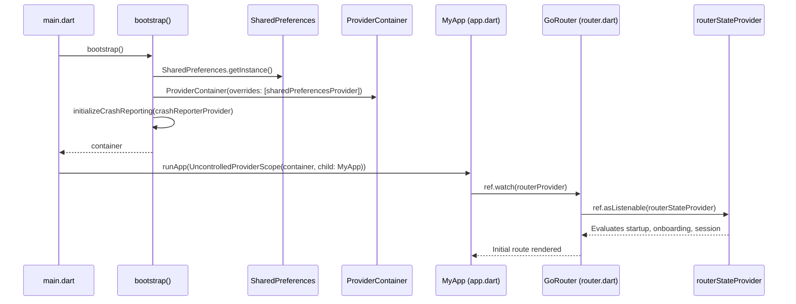

# Architectural Breakdown of Stark VMS

This document provides a comprehensive structural audit and technical explanation of the Stark VMS frontend architecture.

---

## 1. Application Initialization Flow

### Key Initialization Highlights:
- **`lib/main.dart`**: Ensures Flutter bindings are initialized and boots the app inside an `UncontrolledProviderScope` using the pre-configured `ProviderContainer` from `bootstrap()`.
- **`lib/src/core/bootstrap.dart`**:
  - Sets system UI overlay styles (transparent status and navigation bars).
  - Locks device orientation (`portraitUp`).
  - Pre-initializes asynchronous `SharedPreferences` and injects it into `sharedPreferencesProvider.overrideWithValue(prefs)`.
  - Attaches `RiverpodObserver` to log all provider events.
  - Dynamically switches crash reporting: `LoggingCrashReporter` in debug, `FirebaseCrashlyticsReporter` in release.
- **`lib/app.dart`**:
  - Binds `MaterialApp.router` to `routerProvider` and `themeModeProvider`.
  - Injects `context.lightTheme` and `context.darkTheme` via the `ThemeDataExtension`.

---

## 2. Layer Separation & Responsibilities

### `lib/src/core/`
Technical backbone with zero domain dependencies:
- **`extensions/`**:
  - `context_extension.dart`: `mq`, screen size (`mqSizeOfWidth`, `mqSizeOfHeight`), insets, and platform queries (`isIos`, `isAndroid`, `isTablet`).
  - `date_time_format.dart`: `DateTimeFormatter` supporting 9 `DateFormatType` formats.
  - `nullable_int_display.dart`: Fallback string formatting for nullable ints.
  - `riverpod_extensions.dart`: `RefAsListenable` bridge converting Riverpod providers to `ValueListenable` with automatic subscription disposal.
  - `string_extension.dart`: Truncation (`showUntil`), empty fallbacks (`ifEmpty`), regex email validation (`isValidEmail`), color hex parsing (`tryParseColor`), URI encoding, and safe null checks.
- **`logger/`**:
  - `app_logger.dart`: Structured logging with method counts, emoji flags, and debug/production level filtering.
  - `riverpod_log.dart`: Automatic lifecycle logging of provider creation, mutation, disposal, and errors.
- **`base/`**:
  - `crash_reporter.dart`: Crash reporting interface.

---

### `lib/src/domain/`
Contract layer containing pure business definitions:
- **`repositories/`**: Abstract interfaces defining data requirements:
  - `AuthenticationRepository`: `login()`, `logout()`, `rememberMe()`, `restoreSession()`.
  - `RouterRepository`: `hasSession()`, `sessionStream`, `isOnboardingCompleted()`.
  - `LocaleRepository`: `getLanguage()`, `setLanguage()`.
- **`entities/`**: Clean enterprise business models.

---

### `lib/src/data/`
Infrastructure implementations for storage, API, and repositories:
- **`services/cache/`**:
  - `CacheService` contract + `SharedPreferencesService` implementation.
  - Typed `CacheKey` enum (`accessToken`, `refreshToken`, `isLoggedIn`, `isOnBoardingCompleted`, `rememberMe`, `role`, `language`, `themeMode`, `user`).
- **`services/network/`**:
  - Dio client configured with standard timeouts and headers.
  - Retrofit `RestClient` generated via `build_runner`.
  - `Api.call<T>` unified error handling and response extraction.
  - `SecureTokenStore` backed by `flutter_secure_storage`.
  - `TokenManager` tracking in-memory tokens with session epoch validation.
  - `AccessTokenInterceptor` and `TokenRefreshInterceptor`.
- **`repositories/`**: Concrete implementations that bridge domain contracts with remote APIs and local storage.

---

### `lib/src/presentation/`
All UI elements, feature slices, and presentation state:
- **`core/application_state/`**: Global state providers:
  - `startupProvider`: Runs startup routines (session restoration, locale, theme) before first screen renders.
  - `sessionStatusProvider`: Reactive stream of `authenticated` / `unauthenticated` states.
  - `themeModeProvider`: Persisted theme mode manager (`system`, `light`, `dark`).
  - `localizationProvider`: Persisted locale manager.
- **`core/router/`**: Complete `go_router` declaration, path enums, redirect gating, and part files.
- **`core/theme/`**: Design tokens, primitives, color extensions, dimensions, typography, and context getters.
- **`core/widgets/`**: Reusable UI widgets.
- **`feature/`**: Feature modules containing `view/`, `view_model/`, and `widgets/`.

