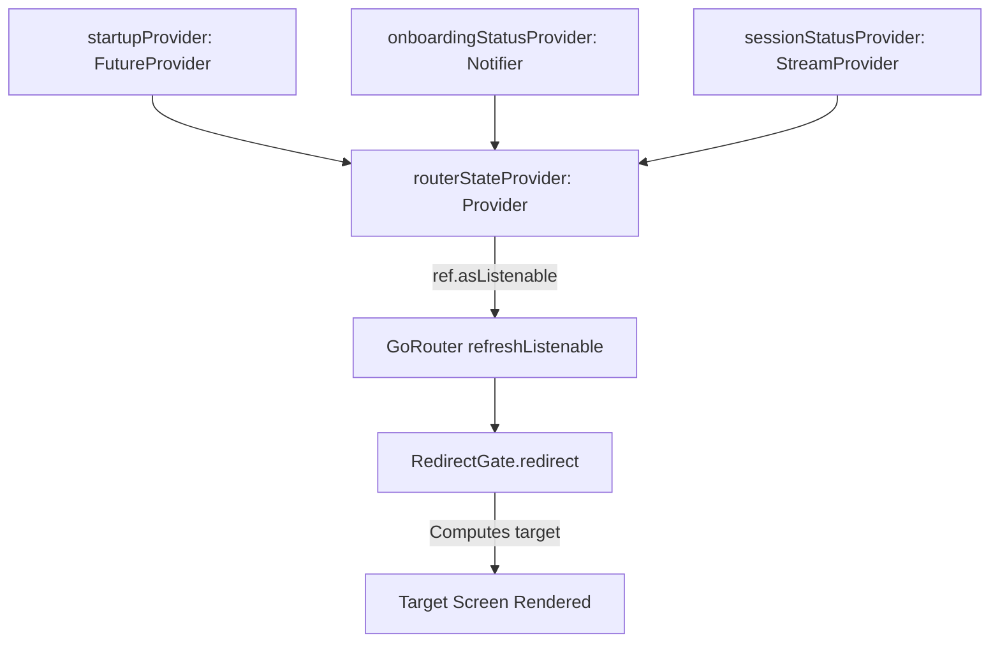

# Reactive Routing & Navigation Guide

This document details the navigation architecture in Stark VMS powered by **`go_router`** and **Riverpod**.

---

## 1. Declarative, State-Driven Routing Model

In standard imperative Flutter navigation, views trigger transitions using `Navigator.push()` or `context.go('/login')`. 

In Stark VMS, navigation is **purely reactive and driven by state**:



1. **`startupProvider`**: Ensures session tokens, saved theme, and saved locale are evaluated before deciding on an initial screen.
2. **`onboardingStatusProvider`**: If `isOnBoardingCompleted` is false, pins navigation to `Routes.onboarding`.
3. **`sessionStatusProvider`**: Listens to `TokenManager.sessionStream`. When tokens exist, emits `SessionStatus.authenticated`; when cleared (via logout or expired refresh), emits `SessionStatus.unauthenticated`.
4. **`routerStateProvider`**: Purely derives the target gate route:
   - If startup is pending or errored ➡️ `Routes.splash`
   - If onboarding not completed ➡️ `Routes.onboarding`
   - If unauthenticated ➡️ `Routes.login`
   - If authenticated ➡️ `Routes.homeScreen`

---

## 2. The Gating Logic: `RedirectGate`

`RedirectGate` is an abstract class with zero Flutter or Riverpod dependencies, making it 100% unit-testable:

```dart
static String? redirect(String path, Routes gate) {
  return switch (gate) {
    Routes.splash => path == Routes.splash.path ? null : Routes.splash.path,
    Routes.onboarding => path == Routes.onboarding.path ? null : Routes.onboarding.path,
    Routes.login => _isAuthFlowPath(path) ? null : Routes.login.path,
    _ => _isGateOnlyPath(path) ? Routes.homeScreen.path : null,
  };
}
```

### Safety Features:
- **Loop Prevention**: Checks `path == target ? null : target`.
- **Auth Flow Protection**: `_isAuthFlowPath` allows login, registration, password reset, and email verification routes when the unauthenticated gate is active.
- **Gate-Only Trapping**: `_isGateOnlyPath` prevents authenticated users from navigating backward to splash, onboarding, login, or the root `/`.

---

## 3. Router Configuration & Modular Parts

The router is configured in `lib/src/presentation/core/router/router.dart`.

To prevent massive single-file routing configurations, sub-routes are declared as **part files** in `parts/`:
- `authentication_routes.dart`
- `onboarding_routes.dart`

### Adding a New Route:
1. Define the route path in `Routes` enum (`routes.dart`):
   ```dart
   enum Routes {
     // ...
     vehicles('/vehicles'),
     drivers('/drivers');
   }
   ```
2. Create or extend a part file in `parts/`:
   ```dart
   part of '../router.dart';

   List<GoRoute> _vmsRoutes(Ref ref) {
     return [
       GoRoute(
         path: Routes.vehicles.path,
         name: Routes.vehicles.name,
         pageBuilder: (context, state) => buildTransitionPage(
           child: const VehiclesScreen(),
           key: ValueKey(Routes.vehicles.name),
           type: AppTransitionType.fade,
         ),
       ),
     ];
   }
   ```
3. Include the part file in `router.dart` and add `..._vmsRoutes(ref)` to the `routes` list.

---

## 4. Custom Page Transitions

Use `buildTransitionPage` from `custom_transition_page.dart`:
```dart
buildTransitionPage(
  child: const MyScreen(),
  key: ValueKey('MyScreenKey'),
  type: AppTransitionType.fade, // or rightToLeft, bottomToTop, scale, none
  duration: const Duration(milliseconds: 200),
)
```
For Web desktop screens, `AppTransitionType.fade` or `none` is recommended to avoid jarring mobile slide animations.

---

## 5. Fallback Route: `NotFoundScreen`

Any invalid URL typed in the web address bar or broken link automatically routes to `NotFoundScreen(uri: state.uri)`, which presents an error icon, the broken URI, and a direct "Go to Home" button.

