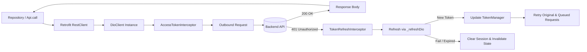

# Network & Authentication Architecture

This document describes the Dio, Retrofit, Interceptor, and Token Management pipeline in Stark VMS.

---

## 1. Network Pipeline Overview



---

## 2. Dio Client Configuration

`DioClient.getInstance(Ref ref)` in `lib/src/data/services/network/dio_client.dart`:
- `BaseOptions`:
  - `baseUrl`: Driven by `Endpoints.base` (`String.fromEnvironment("BASE_URL")`).
  - `connectTimeout`: 30 seconds.
  - `receiveTimeout`: 30 seconds.
  - Headers: `'Content-Type': 'application/json'`, `'Accept': 'application/json'`.
- Interceptor Chain:
  1. `AccessTokenInterceptor`: Attaches `Bearer <accessToken>`.
  2. `TokenRefreshInterceptor`: Intercepts 401s, executes token refresh, queues concurrent requests, and retries.
  3. `LogInterceptor`: Active only in `kDebugMode` (with body logging disabled to prevent token leakage).

---

## 3. Retrofit Client: `RestClient`

Defined in `lib/src/data/services/network/rest_client.dart` with `@RestApi(baseUrl: Endpoints.base)`.

```dart
@RestApi(baseUrl: Endpoints.base)
abstract class RestClient {
  factory RestClient(Dio dio, {String? baseUrl, ParseErrorLogger errorLogger}) = _RestClient;

  @POST(Endpoints.login)
  Future<HttpResponse> login(@Body() Map<String, dynamic> request);
}
```

Whenever updating `RestClient`, generate the code:
```powershell
dart run build_runner build --delete-conflicting-outputs
```

---

## 4. Unified Request Wrapper: `Api.call<T>`

Located in `lib/src/data/services/network/api_handler.dart`.

Every remote call must be executed through `Api.call<T>`:
```dart
await Api.call<T>(
  action: remote.someMethod(),
  onSuccess: (data) async {
    // Process response data
  },
  onError: (errorMessage) async {
    // Handle or rethrow domain exception
  },
);
```

### Advantages:
- Catches all `DioException` types.
- Extracts backend JSON response `'message'` field if present (e.g. `{"message": "Invalid credentials"}`).
- Logs exceptions with stack trace to `AppLogger.error()`.
- Prevents silent unhandled network crashes.

---

## 5. Token Management & Safe Concurrency

### `SecureTokenStore`
- Implements `TokenStore`.
- Uses `flutter_secure_storage` with Android AES-GCM options and iOS Keychain `first_unlock`.
- Swallows errors and returns `null` instead of throwing raw crypt exceptions into stack traces.

### `TokenManager`
- In-memory cache + persistent storage for `_accessToken` and `_refreshToken`.
- **Session Epoch Counter (`_sessionEpoch`)**:
  - Incremented on every `clearSession()`.
  - When a refresh request completes, it provides `expectedEpoch: currentEpoch`.
  - If the user logged out while a refresh was in flight, the epoch will have incremented, and `saveTokens` will reject the old token, preventing session resurrection.
- Exposes `sessionStream`:
  - `_sessionController.stream.distinct()` ensures identical consecutive session status events are dropped, avoiding redundant router re-evaluations.

### `TokenRefreshInterceptor`
- Intercepts `401 Unauthorized` responses where `options.extra['retry'] != true`.
- If already refreshing (`_isRefreshing == true`), adds the request and handler to `_queue`.
- Otherwise, sets `_isRefreshing = true` and invokes `_refreshAccessToken()`.
- Uses an isolated `_refreshDio` instance that does **not** carry interceptors, avoiding recursive refresh loops.
- Upon receiving a new access token:
  1. Retries the triggering request with `options.extra['retry'] = true`.
  2. Iterates through all queued requests and retries them.
- If refresh fails:
  1. Calls `tokenManager.clearSession()`.
  2. Rejects all queued requests.
  3. Triggers reactive logout in `sessionStatusProvider` and redirects to login.

