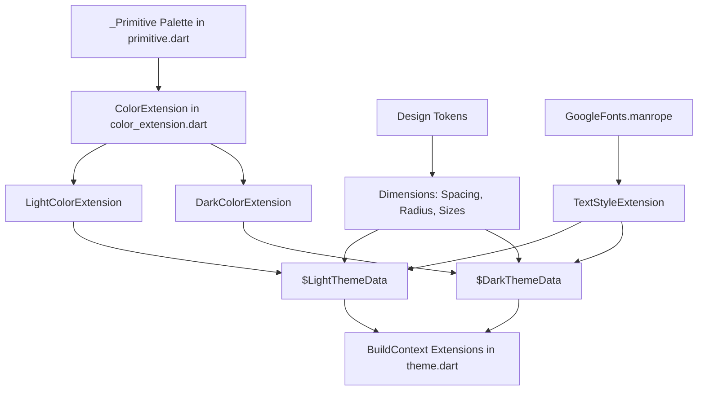

# Theme & Design Token Architecture

This document details the centralized Design System implemented via Flutter `ThemeExtension` in Stark VMS.

---

## 1. Design Token Architecture



All design values flow from:
1. `_Primitive`: Raw hex colors matching Figma design tokens.
2. `ColorExtension`: Strongly typed color contract.
3. `Dimensions`: Spacing, Radius, and Component Size scales.
4. `TextStyleExtension`: Typography scale based on GoogleFonts Manrope.
5. `BuildContext` Extension: Ergonomic getters for UI code.

---

## 2. Palette Mapping (`_Primitive`)

| Design Token Slot | Value | Primary UI Application |
| :--- | :--- | :--- |
| `brandPrimary` | `Color(0xFF002335)` | Primary brand buttons, active tabs, highlights |
| `brandSecondary` | `Color(0xFF00131C)` | Secondary headers, deep surfaces |
| `accentYellow` | `Color(0xFFFFC107)` | Rating stars, warning flags, inspections |
| `accentBlue` | `Color(0xFF167EE6)` | Info banners, telemetry indicators |
| `accentPurple` | `Color(0xFF6334C1)` | Special badges, premium features |
| `scaffoldLight` | `Color(0xFFF5F1E8)` | Light mode background |
| `scaffoldDark` | `Color(0xFF141414)` | Dark mode background |
| `surfaceDark` | `Color(0xFF2B2B2B)` | Dark cards, dialogs, drawers |
| `textPrimaryLight` | `Color(0xFF1F1F1F)` | High contrast body & titles (light mode) |
| `textPrimaryDark` | `Color(0xFFFFFFFF)` | High contrast body & titles (dark mode) |
| `textSecondaryLight`| `Color(0xFF757575)` | Subtitles, hints, labels (light mode) |
| `textSecondaryDark` | `Color(0xFFB0B0B0)` | Subtitles, hints, labels (dark mode) |
| `inputFill` | `Color(0xFFFDF8F8)` | Form field fill background |
| `inputBorder` | `Color(0xFFE5E5E5)` | Unfocused input borders |
| `borderLight` | `Color(0xFFE0E0E0)` | Dividers, card borders (light mode) |
| `borderDark` | `Color(0xFF333333)` | Dividers, card borders (dark mode) |
| `success` | `Color(0xFF008000)` | Operational status, active vehicles |
| `error` | `Color(0xFFFF0000)` | Critical faults, overdue maintenance |
| `warning` | `Color(0xFFFFFF00)` | Low fuel, scheduled inspection due |

---

## 3. Dimensions Design Tokens

### Spacing (`context.spacing.*`)
| Token | Pixels | Common Use |
| :--- | :--- | :--- |
| `xxxs` | 1.5 px | Micro borders / hairline dividers |
| `xxs` | 2.0 px | Tight inline padding |
| `xs` | 4.0 px | Badge padding, tight icon gaps |
| `sm2` | 6.0 px | Compact list item gaps |
| `sm` | 8.0 px | Standard margin / item spacing |
| `md` | 12.0 px | Form field gaps, inner card padding |
| `lg` | 16.0 px | Standard screen padding, card margin |
| `lg2` | 20.0 px | Section header padding |
| `xl` | 24.0 px | Outer screen margins on tablet/web |
| `xxl` | 32.0 px | Major section division |
| `xxl2`| 40.0 px | Hero section spacing |
| `xxxl`| 48.0 px | Empty state vertical padding |
| `offset` | 64.0 px | Layout offsets |

### Radius (`context.radius.*`)
| Token | Pixels | Common Use |
| :--- | :--- | :--- |
| `xxs` | 2.0 px | Subtle edge rounding |
| `xs` | 4.0 px | Small tags |
| `sm` | 8.0 px | Buttons, small cards |
| `md` | 12.0 px | Text fields, dialogs, dropdowns |
| `lg` | 16.0 px | Large dashboard cards |
| `xl` | 24.0 px | Bottom sheets, modal headers |
| `pill` | 999.0 px | Status chips, circular avatars |

### Component Sizes (`context.sizes.*`)
| Token | Pixels | Common Use |
| :--- | :--- | :--- |
| `xs` | 16.0 px | Mini inline icons |
| `sm` | 24.0 px | Standard action icons |
| `md` | 32.0 px | Small buttons, avatar thumbnails |
| `md2` | 40.0 px | Standard button height, user avatars |
| `lg` | 48.0 px | Primary CTA buttons, dropdown fields |
| `lg2` | 56.0 px | Header icons, large touch targets |
| `xl` | 64.0 px | Hero icons |
| `xxl` | 80.0 px | Empty state illustration circles |
| `xxxl` | 100.0 px | Profile photo upload zones |

---

## 4. Typography Scale (`context.textStyle.*`)

Powered by **GoogleFonts.manrope**:

| Style Getter | Size | Weight | Height | Letter Spacing |
| :--- | :--- | :--- | :--- | :--- |
| `headLineLarge` | 24 px | `FontWeight.w600` | 1.40 | 0.0 |
| `headLineMedium`| 20 px | `FontWeight.w600` | 1.40 | 0.0 |
| `headLineSmall` | 18 px | `FontWeight.w500` | 1.33 | 0.0 |
| `bodyLarge` | 16 px | `FontWeight.w400` | 1.50 | 0.0 |
| `bodyMedium` | 14 px | `FontWeight.w400` | 1.42 | 0.0 |
| `bodySmall` | 12 px | `FontWeight.w400` | 1.42 | 0.0 |
| `labelLarge` | 16 px | `FontWeight.w500` | 1.15 | 1.0 |
| `labelMedium` | 14 px | `FontWeight.w500` | 1.15 | 1.0 |
| `labelSmall` | 12 px | `FontWeight.w500` | 1.15 | 1.0 |

---

## 5. BuildContext Helper Summary

```dart
// Colors
context.color.primary;
context.color.scaffoldBackground;
context.color.border;
context.color.text.primary;
context.color.text.secondary;

// Dimensions
context.spacing.lg;
context.radius.md;
context.sizes.md;

// Typography
context.textStyle.headLineMedium;
context.textStyle.bodyLarge;

// Theme Modes
context.isDark;
context.isLight;
context.lightTheme;
context.darkTheme;
```

