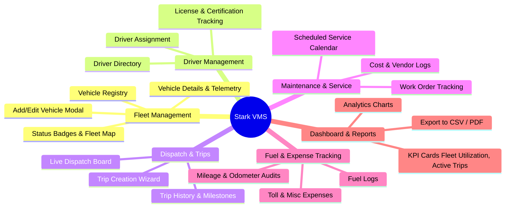

# Stark VMS — Product Roadmap & Next Steps

This document outlines the recommended roadmap and architectural plan to expand Stark VMS from this template into a full-scale Vehicle Management System for web.

---

## 🗺️ High-Level Feature Architecture

---

## Phase 1: Web Shell & Dashboard Layout
**Objective**: Build a responsive web application shell tailored for desktop browsers and tablets.

1. **Dashboard Shell (`DashboardLayout`)**:
   - Collapsible Left Navigation Sidebar (Dashboard, Fleet, Drivers, Trips, Maintenance, Settings).
   - Top Navigation Header (Breadcrumbs, Search bar, Organization selector, Light/Dark toggle via `themeModeProvider`, User Profile dropdown with `LogoutNotifier`).
   - Breadcrumbs navigation linked to `go_router`.
2. **Dashboard Overview Screen (`HomeScreen`)**:
   - Fleet Metrics KPI cards: Total Vehicles, Active on Road, In Maintenance, Fuel Efficiency.
   - Quick Action buttons: "Register Vehicle", "Create Dispatch", "Log Service".
   - Recent Trip Activity feed.

---

## Phase 2: Fleet / Vehicle Registry
**Objective**: Complete vehicle lifecycle management.

1. **Data Layer**:
   - `Vehicle` entity & `VehicleModel` DTO.
   - Retrofit endpoints: `GET /vms/vehicles`, `POST /vms/vehicles`, `GET /vms/vehicles/{id}`, `PUT /vms/vehicles/{id}`.
   - `VehicleRepository` & `VehicleRepositoryImpl`.
2. **Presentation Layer**:
   - `VehiclesScreen`:
     - Filter toolbar: Search by VIN/Plate, Status filter (`AppDropdown`), Fuel type filter (`MultiSelectDropdown`).
     - Responsive Data Table or Grid cards for fleet items.
     - Empty state via `EmptyStateWidget`.
   - `VehicleDetailsScreen`:
     - Specifications (Make, Model, Year, VIN, Engine, Fuel type).
     - Live status pill badge (`Active`, `Maintenance`, `Out of Service`).
     - Odometer and service history tabs.
   - `VehicleFormModal`: Form to add/edit vehicle using `AppTextField` and `AppDropdown`.

---

## Phase 3: Driver Management
**Objective**: Track drivers, licenses, and assignments.

1. **Data Layer**:
   - `Driver` entity & `DriverModel` DTO.
   - Endpoints: `/vms/drivers`.
   - `DriverRepository` contract and implementation.
2. **Presentation Layer**:
   - `DriversScreen`: Driver cards or table displaying license expiry warning badges, contact details, assigned vehicle.
   - Assign/Unassign driver workflow.

---

## Phase 4: Trips & Dispatch Operations
**Objective**: Track routes, trips, and dispatches.

1. **Data Layer**:
   - `Trip` entity: Origin, Destination, Vehicle ID, Driver ID, Start Odometer, End Odometer, Departure/Arrival times.
   - Endpoints: `/vms/trips`.
2. **Presentation Layer**:
   - `DispatchBoardScreen`: Kanban-style or categorized board (`Scheduled`, `In Transit`, `Completed`).
   - Dispatch creation dialog with validation.

---

## Phase 5: Maintenance & Work Orders
**Objective**: Fleet servicing, repairs, and inspections.

1. **Data Layer**:
   - `MaintenanceRecord` entity: Service type, service date, cost, odometer, status.
   - Endpoints: `/vms/maintenance`.
2. **Presentation Layer**:
   - `MaintenanceScreen`: Scheduled services calendar, overdue inspection alerts (`CustomToast` / Warning banners), work order details.

---

## 🛠️ Implementation Checklist for Next Feature

When ready to implement any phase above:
1. Follow [`.agents/skills/vms-feature-builder/SKILL.md`](../skills/vms-feature-builder/SKILL.md).
2. Use rules in [`.agents/rules/`](../rules/) to ensure code conforms to project standards.
3. Keep code strictly using design tokens from `context.color`, `context.spacing`, `context.radius`, and `context.textStyle`.

